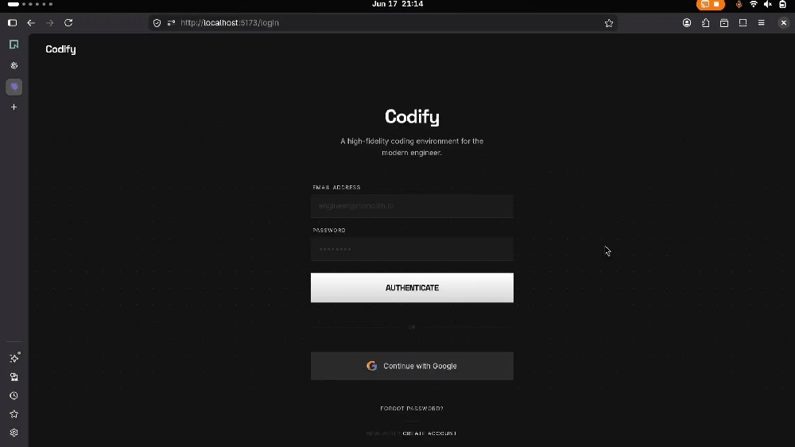
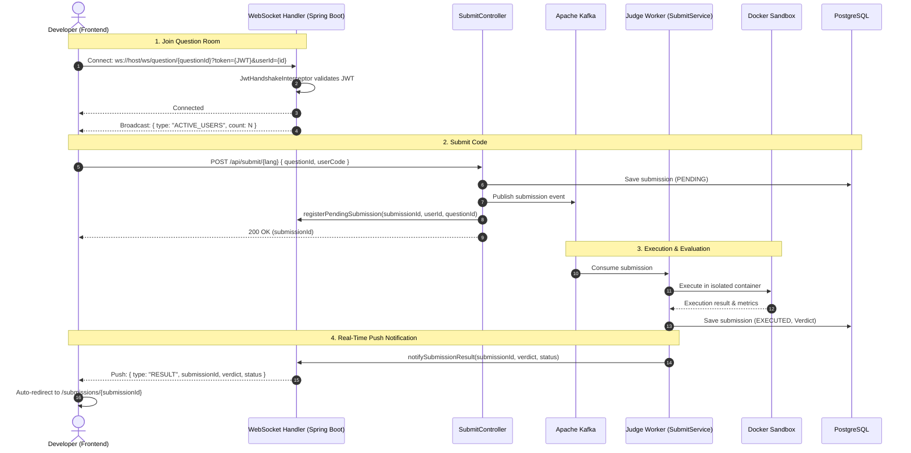

# Codify 🚀

Codify is a high-performance, LeetCode-style online judge platform built with **Spring Boot** and **React**. It features a robust, containerized code execution engine, real-time submission tracking via **Kafka**, and AI-powered code analysis using **Google Gemini**.

## 🎬 Demo

[](https://www.linkedin.com/posts/suman990_softwareengineering-springboot-java-ugcPost-7473074463694319618-tpXN/?utm_source=share&utm_medium=member_desktop&rcm=ACoAAF2dqpgB8QbXMWRrKvJwO2FRaJxpUkCIT-A)

*Click the GIF to see the full demo video!*

> **Note:** The project is not live at the moment as I don't currently have access to a VPS to deploy it. You can run it locally by following the setup instructions below.


## ✨ Features

- **Multi-Language Support**: Execute code in **Java**, **Python**, and **C++**.
- **Real-Time WebSockets & Live Presence**: Instant submission results pushed directly to the client via WebSockets (zero polling) and a live counter showing how many developers are currently attempting each problem.
- **Containerized Sandbox**: Secure code execution using isolated Docker containers with resource limits (CPU/Memory) and disabled networking.
- **Asynchronous Processing**: Submissions are queued via **Apache Kafka** to handle high loads and ensure system stability.
- **AI Code Analysis**: Automated time/space complexity analysis and code feedback powered by **Google Gemini 2.0 Flash**.
- **Interactive Code Editor**: Integrated **Monaco Editor** (the engine behind VS Code) with syntax highlighting and themes.
- **Advanced Dashboard**: Track progress with daily submission heatmaps, problem difficulty breakdown (Easy/Medium/Hard), and acceptance rates.
- **OAuth2 Integration**: Secure login with **Google OAuth2** and **JWT**-based authentication.
- **Admin Dashboard**: Comprehensive tools for managing problems, users, and monitoring system health.

## 🛠️ Tech Stack

### Backend


- **AI Orchestration**: Google Gemini API (gemini-2.0-flash)
- **Messaging**: Kafka (Aiven)
- **Real-Time Layer**: Spring WebSocket (`TextWebSocketHandler`)
- **Database**: PostgreSQL (Neon.tech)

### Frontend


- **Editor**: Monaco Editor (VS Code Engine)
- **State**: React Hooks & Context API
- **Live Connection**: Native Browser WebSocket API

## 🏗️ Architecture

Codify follows a distributed architecture designed for scalability:

1.  **Frontend**: React app hosted on Vite, communicating via REST APIs and WebSockets.
2.  **API Gateway & WebSocket Server**: Spring Boot handles routing, JWT auth, problem management, and per-question live rooms.
3.  **Message Queue**: Submissions are pushed to language-specific Kafka topics (`JavaSubmissions`, etc.).
4.  **Judge Workers**: `SubmitService` consumes Kafka messages and manages a pool of Docker containers.
5.  **Execution Sandbox**: Code is executed inside pre-warmed Docker containers to minimize latency.
6.  **AI Analyzer**: Post-execution, the code is sent to **Google Gemini 2.0 Flash** for complexity analysis.
7.  **Real-Time Push Service**: Notifies the awaiting user session over WebSocket as soon as judging and persistence finish.

## 🔌 WebSocket & Real-Time Architecture

To eliminate inefficient polling (previously querying `/api/submissions/{id}` every 2 seconds), Codify uses a per-question WebSocket room architecture:



### Core WebSocket Components

1. **`JwtHandshakeInterceptor`**:
   - Authenticates the WebSocket connection before upgrading from HTTP.
   - Extracts the JWT and `userId` from query parameters (`?token=...&userId=...`) since the browser's native WebSocket API does not support custom headers.
   - Validates the token and attaches `questionId`, `userId`, and `userEmail` as session attributes.

2. **`SubmissionWebSocketHandler`**:
   - **Per-Question Rooms**: Maintains thread-safe room sets (`ConcurrentHashMap<String, CopyOnWriteArraySet<WebSocketSession>>`) mapping `questionId` to active sessions.
   - **Active User Presence**: On connection establish/close, automatically broadcasts `{ "type": "ACTIVE_USERS", "count": N }` to all clients in that problem room.
   - **Targeted Result Routing**: Maintains a `pendingSubmissions` map (`ConcurrentHashMap<Long, WebSocketSession>`) linking each `submissionId` to the specific user's session. When code evaluation completes, the result is sent directly to the awaiting session.

3. **Frontend Integration (`Problem.jsx`)**:
   - Replaced interval-based polling (`setInterval` every 2s) with native `WebSocket`.
   - Displays a live animated badge in the top navigation bar showing how many users are currently attempting the problem.
   - Listens for `RESULT` messages to instantly transition the UI and navigate to the submission report page.
   - Includes automatic exponential/heartbeat reconnection resilience for dropped connections.

## 🔄 Code Execution Flow

The platform uses a sophisticated multi-stage pipeline for code execution:

1.  **Submission**: User submits code via Monaco Editor on the problem page (connected via WebSocket to `/ws/question/{questionId}`).
2.  **Queueing & WS Registration**: Backend receives the request, pushes a `Submission` object to **Kafka**, and registers the pending submission with `SubmissionWebSocketHandler`.
3.  **Acquisition**: A judge worker picks up the message and acquires an idle container from the `ContainerPoolService`.
4.  **Preparation**: The worker creates a temporary workspace in `backend/sandbox/`, writes the user's code and the problem's "Main" wrapper.
5.  **Execution**: The workspace is copied into the container using `docker cp`. The code is compiled and executed via `docker exec` with a 10-second timeout.
6.  **Parsing**: Standard output is parsed for specific tokens (`TOTAL:`, `TIME_TAKEN:`) to determine the verdict.
7.  **AI Analysis**: If the code passes, **Google Gemini 2.0 Flash** analyzes the code for time/space complexity and provides descriptive feedback.
8.  **Persistence**: Results are saved to PostgreSQL, and user/question statistics are updated.
9.  **Real-Time Notification**: The worker notifies `SubmissionWebSocketHandler`, which immediately pushes a `RESULT` message to the user's active WebSocket connection, automatically redirecting them to their submission analysis.

## 💾 Database Schema

The system uses a relational schema with specialized collections for statistics:

-   **User**: Stores profile info, solved/attempted question IDs, and a heatmap map (`Map<LocalDate, Integer>`).
-   **Question**: Contains problem descriptions, boilerplate code for all languages, test wrappers (`main_java`, etc.), and performance histograms.
-   **Submission**: Records every attempt with code snippets, execution time, memory usage, and AI-generated complexity analysis.
-   **Discussion/Solution**: Community-driven content for each problem.

## 🚀 Getting Started

### Prerequisites
- Java 21+
- Node.js 18+
- Docker
- Kafka & Redis (Cloud or Local)

### Backend Setup
1. Navigate to the backend directory: `cd backend`
2. Create a `.env` file based on the provided template:
   ```env
   DB_URL=jdbc:postgresql://your-neon-url
   DB_USER=your-user
   DB_PASSWORD=your-password
   REDIS_URL=redis://your-redis-url
   GOOGLE_CLIENT_ID=your-google-id
   GOOGLE_CLIENT_SECRET=your-google-secret
   KAFKA_BOOTSTRAP_SERVERS=your-kafka-url
   GEMINI_API_KEY=your-gemini-key
   ```
3. Install dependencies and run:
   ```bash
   ./mvnw spring-boot:run
   ```

### Frontend Setup
1. Navigate to the frontend directory: `cd frontend`
2. Install dependencies:
   ```bash
   npm install
   ```
3. Start the development server:
   ```bash
   npm run dev
   ```

### Docker Sandbox Setup
The judge system requires specific Docker images. Run the following to pull them:
```bash
docker pull python:3.9-slim
docker pull gcc:latest
# For Java, ensure you have a custom image named 'java-sandbox' or update ContainerPoolService.java
```

## 🔒 Security
- **Sandbox Isolation**: Containers run with `--network none` and restricted system resources.
- **Stateless Auth**: JWT-based session management.
- **CORS**: Configured to allow only trusted origins.


